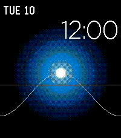
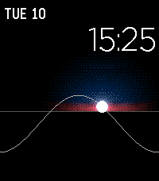
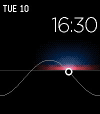
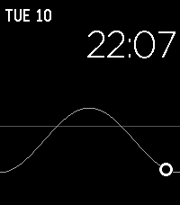

# Solar

A Pebble Time 2 (emery) watchface inspired by the Apple Watch Solar face. It plots the sun's elevation over the day for your location and shows a glowing sun at the current time.

| Day | Sunset | Dusk | Night |
|:---:|:---:|:---:|:---:|
|  |  |  |  |

- The curve runs from midnight (left) to midnight (right). The grey line is the horizon.
- The glow changes with the sun's elevation: blue during the day, red and pink at the horizon, and a hollow ring when the sun is below the horizon.
- Your location comes from the phone and is cached on the watch. It falls back to 50°N, 8°E until the phone reports a location.
- The face redraws once per minute.

### Interactive mode

- Tap the screen to show markers for sunrise, solar noon, now and sunset on the sun path.
- Swipe left or right to move the sun to the next or previous marker. The top left shows that marker's time and its offset from now (e.g. `+ 01:20 h`). The current time moves to the top right.
- Tap again to go back to the normal face. It also returns on its own after 30 seconds without input.

## Build and install

Requires the [Pebble SDK](https://developer.repebble.com/).

```bash
pebble build
pebble install --emulator emery   # emulator
pebble install --cloudpebble      # watch
```

To preview a specific time, set `DEBUG_FAKE_MINUTE` in `src/c/main.c` to a minute of the day (e.g. `990` for 16:30).
